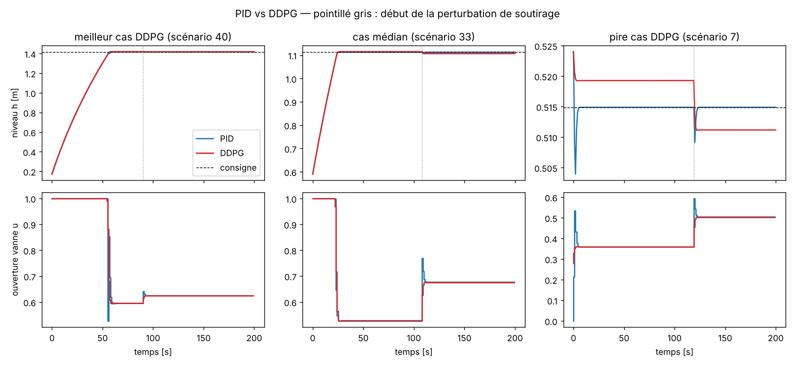
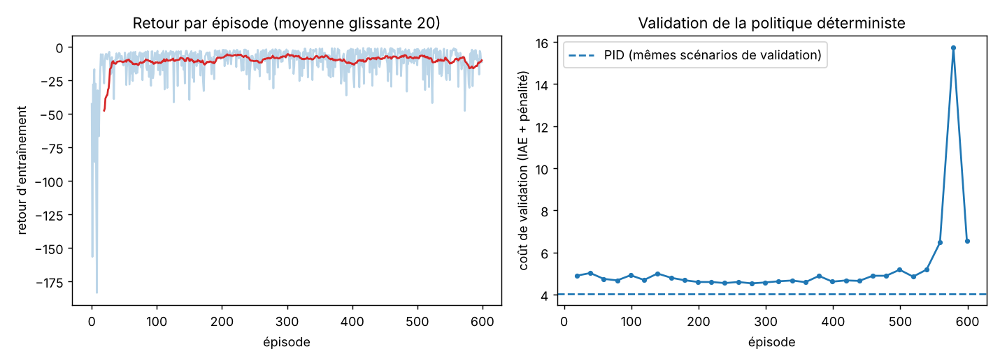

# regulation-niveau-d-eau

Régulation du niveau d'eau d'une cuve par **apprentissage par renforcement (DDPG)**, comparée à un **PID**
classique, avec portage de la politique apprise en **C embarqué**.

Tout est reproductible en Python (numpy, gymnasium) : simulateur, PID, DDPG écrit en numpy pur, évaluation,
export C et tests. Aucune dépendance à PyTorch ni à MATLAB.

> **À lire avant de citer ces résultats.** Ce dépôt est une réimplémentation Python/C sur une cuve **simulée**.
> Ce n'est pas le projet MATLAB/Simulink (RL Toolbox, Simulink Coder) ni la cuve de laboratoire : le modèle, les
> paramètres et les chiffres ci-dessous ne sont pas ceux de ce travail.

## Résultats

100 scénarios de test jamais vus (graine 123) : niveau initial, consigne et perturbation de soutirage tirés
au hasard. Moyenne ± écart-type sur les scénarios.

| Métrique | PID | DDPG |
|---|---|---|
| IAE [m·s] | 7,4718 ± 8,4336 | 7,9564 ± 8,3617 |
| ISE [m²·s] | 4,0620 ± 6,1916 | 4,0639 ± 6,1913 |
| Dépassement [m] | 0,0027 ± 0,0055 | 0,0021 ± 0,0012 |
| Temps de réponse 2 % [s] | 23,18 ± 14,22 | 26,05 ± 13,48 |
| Erreur finale \|e\| [m] | 0,0000 ± 0,0000 | 0,0030 ± 0,0026 |
| Variation totale de u | 1,06 ± 0,36 | 0,56 ± 0,09 |

Le DDPG a un IAE plus faible que le PID dans **0 scénario sur 100**.

Lecture honnête :

- Le PID, réglé par recherche aléatoire sur le même critère que la récompense, est légèrement **meilleur** en
  précision (IAE, temps de réponse) et annule l'erreur statique. L'agent DDPG garde un écart résiduel d'environ
  3 mm.
- Le DDPG produit une commande **deux fois plus douce** (variation totale de u divisée par ~1,9) et dépasse moins.
- La cuve est un système du premier ordre sans bruit de mesure, cas où un PI est quasi optimal : on ne
  s'attend pas à ce que le RL le batte. L'intérêt du RL se jugerait sur des plants non linéaires, bruités ou
  avec contraintes complexes.
- Une seule graine d'entraînement. L'instabilité visible en fin d'entraînement (`results/apprentissage.png`)
  montre qu'un autre tirage peut donner un résultat différent. La politique conservée est celle du meilleur
  coût de validation.




## Contenu

| Chemin | Rôle |
|---|---|
| `src/tank_env.py` | Modèle de la cuve (`A·dh/dt = q_max·u − c·√h − d`) et environnement Gymnasium |
| `src/pid.py` | PID discret, anti-windup par intégration conditionnelle |
| `src/ddpg_numpy.py` | DDPG en numpy (réseaux, Adam, rejeu, cibles) |
| `src/evaluation.py` | Boucle de simulation et métriques (IAE, ISE, dépassement, temps de réponse…) |
| `scripts/tune_pid.py` | Réglage du PID (recherche aléatoire) |
| `scripts/train_ddpg.py` | Entraînement de l'agent |
| `scripts/compare.py` | Comparaison PID vs DDPG, figures, tableau |
| `scripts/bellman_check.py` | Vérifications numériques : contraction de Bellman, Monte Carlo, martingale |
| `scripts/export_c.py` | Export des poids vers `c/policy_weights.h` + vecteurs de test |
| `c/` | Contrôleur C embarquable (`rl_controller.c/.h`), banc de test et Makefile |
| `docs/MDP.md` | Formalisation MDP et théorie associée |
| `docs/bibliographie.md` | Étude bibliographique DDPG vs PID |
| `results/` | Gains du PID, poids de l'agent, journaux, tableaux et figures |

## Reproduire

```bash
pip install -r requirements.txt
python scripts/tune_pid.py          # ~1 min,  -> results/pid_gains.json
python scripts/train_ddpg.py --episodes 600 --eval_every 20   # ~1,5 min, -> results/actor.npz
python scripts/compare.py           # -> results/results.md et figures
python scripts/bellman_check.py     # ~1,5 min, vérifications théoriques
python scripts/export_c.py && make -C c test
pytest
```

## Portage C embarqué

`c/rl_controller.c` implémente le réseau 4-64-64-1 sans allocation dynamique : 4545 paramètres (18 180 octets de
flash en `float`), ~4,4 k multiplications-accumulations par pas, seule dépendance `expf()`. Les observations
sont construites exactement comme en Python (`rl_step`). Vérifications automatiques (`tests/test_c_export.py`) :

- écart maximal 2,4·10⁻⁷ avec numpy sur 300 observations aléatoires ;
- niveau simulé en boucle fermée avec le contrôleur C égal à la simulation Python à moins de 1 mm près sur 5 scénarios.

Non testé : exécution sur une vraie cible (microcontrôleur), temps de calcul mesuré, arithmétique en virgule
fixe. Le banc de test tourne uniquement sur PC.

## Limites

- Cuve simulée, sans bruit de mesure, sans retard, sans dynamique de vanne ni de capteur.
- Perturbation de soutirage unique par épisode ; pas d'étude de robustesse aux erreurs de modèle.
- Un seul entraînement, pas d'étude de sensibilité aux hyperparamètres ni à la graine.
- Pas de garantie de convergence pour DDPG avec réseaux de neurones (voir `docs/MDP.md`).
